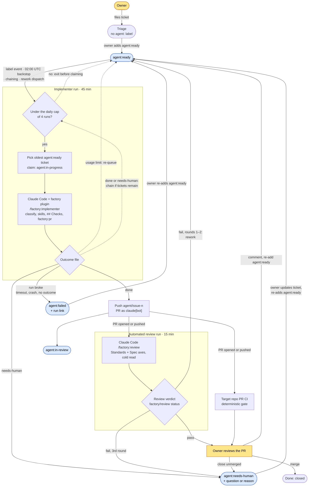

# Factory design

The design of the software factory that builds software across the owner's GitHub repositories. It is ready to hand off for building: every service slot names a product, and both v1 tasks, **implementer** and **automated review**, answer the five questions of the `software-factory` skill.

- **Vocabulary:** the `software-factory` skill (`.claude/skills/software-factory/SKILL.md`) and [`GLOSSARY.md`](../GLOSSARY.md). Terms used here: task, trigger, run, runner, ticket tracker, git host, orchestrator, observability platform, factory repo, target repo, ticket state, review verdict, task contract, factory skill.
- **Provenance:** every decision below was made on the wayfinder map [Software factory design](https://github.com/the-kwisatz-haderach/sw-factory/issues/2) and is recorded in full on the ticket linked from its section. This spec gathers those decisions in one place. Where it summarises, the ticket is the authority.
- **Open items** that must be checked while building are collected in [§13 Verify while building](#13-verify-while-building).

## Overview

How a ticket moves through the factory. Rounded boxes are **ticket states** (the `agent:` labels), and the two outlined groups are the two tasks, each running in the target repo's GitHub Actions. Every run, whatever its outcome, also writes a job summary, a transcript artifact and a Langfuse trace ([§11](#11-observability)). A scheduled board sweep in the factory repo mirrors the labels onto the Projects board ([§9](#9-bookkeeping-jobs)).



## Contents

1. [Problem and standing constraints](#1-problem-and-standing-constraints)
2. [Services](#2-services)
3. [Topology](#3-topology)
4. [Identity and secrets](#4-identity-and-secrets)
5. [Ticket states](#5-ticket-states)
6. [Task instructions](#6-task-instructions)
7. [Task: implementer](#7-task-implementer)
8. [Task: automated review](#8-task-automated-review)
9. [Bookkeeping jobs](#9-bookkeeping-jobs)
10. [Brakes](#10-brakes)
11. [Observability](#11-observability)
12. [Opting a target repo in](#12-opting-a-target-repo-in)
13. [Verify while building](#13-verify-while-building)
14. [Out of scope](#14-out-of-scope)

---

## 1. Problem and standing constraints

**Problem:** ready tickets that nobody builds, and their PRs waiting for review. So v1 has two tasks, **implementer** and **automated review**, and a human reviews every PR. Explore and decompose come later.

**Standing constraints:**

- **One human.** The only human is the owner, `the-kwisatz-haderach`. Every target repo is on GitHub under that account, and one project is one target repo.
- **Model payment:** the owner's existing **Claude subscription** (Max to start), through a `claude setup-token` OAuth token, never an API key. The owner has verified that such a token authenticates the Claude Code Action ([#12](https://github.com/the-kwisatz-haderach/sw-factory/issues/12)).
- **No surprise bills.** No paid service without a hard spending cap. Free tiers are preferred, and slow is acceptable.
- **Split of ownership.** The **factory repo** owns the infrastructure and the **generic** task definitions. Each **target repo** owns its project-specific skills, domain language and automated-check commands.
- **Explicit opt-in.** Nothing runs in a repo that hasn't opted in ([§12](#12-opting-a-target-repo-in)).

## 2. Services

| Slot | Product | Decided in |
| --- | --- | --- |
| Ticket tracker | **GitHub Issues** in each target repo (the source of truth), plus one user-owned **GitHub Projects v2 board** across all target repos, used as a read-only view | [#6](https://github.com/the-kwisatz-haderach/sw-factory/issues/6), [#9](https://github.com/the-kwisatz-haderach/sw-factory/issues/9) |
| Ticket source | **None in v1.** The owner files tickets by hand. (The map never charted a ticket source; this records that gap as a deliberate none.) | — |
| Git host | **GitHub** (personal account, GitHub Free) | [Map Notes](https://github.com/the-kwisatz-haderach/sw-factory/issues/2) |
| Orchestrator | **GitHub Actions**: target-repo events and schedules, a stub workflow calling reusable workflows, and concurrency groups | [#7](https://github.com/the-kwisatz-haderach/sw-factory/issues/7) |
| Runner | **GitHub-hosted Actions runners** (a fresh VM per job) in the target repo | [#7](https://github.com/the-kwisatz-haderach/sw-factory/issues/7) |
| Observability platform | **Langfuse Cloud, Hobby plan (free, no card), EU region**, plus Actions run pages, transcript artifacts and job summaries | [#16](https://github.com/the-kwisatz-haderach/sw-factory/issues/16) |

The model is Claude Code via `anthropics/claude-code-action`, paid for by the subscription ([#3](https://github.com/the-kwisatz-haderach/sw-factory/issues/3)).

With no ticket source, the skill's question "what stops a ticket source filing the same ticket twice?" doesn't apply in v1.

**Rejected alternatives** (details on the tickets):

- an external orchestrator layer such as Cloudflare Workers ([#15](https://github.com/the-kwisatz-haderach/sw-factory/issues/15))
- Claude Code cloud scheduled tasks: vendor lock-in, they post as the owner, and they have an hourly cap ([#14](https://github.com/the-kwisatz-haderach/sw-factory/issues/14))
- sandbox services, which would need a non-Actions orchestrator
- a self-hosted Langfuse, paid Langfuse plans, or a deliberate "none" for observability

## 3. Topology

```
target repo (private)                              factory repo (public)
┌───────────────────────────────────┐              ┌───────────────────────────────────────┐
│ .github/workflows/factory.yml     │  workflow_   │ .github/workflows/implementer.yml     │
│   (stub; forwards only)           │──call @main─▶│ .github/workflows/review.yml          │
│ CLAUDE.md  (## Checks)            │              │ plugin `factory` (skills/, system.md) │
│ secrets: CLAUDE_CODE_OAUTH_TOKEN, │              │ scripts/opt-in, rotation script,      │
│          LANGFUSE_* (optional)    │              │   Langfuse upload script              │
│ labels: agent:*                   │              │ board sweep + rotation reminder (cron)│
│ topic: sw-factory-target          │              │ docs/opt-in.md                        │
└───────────────────────────────────┘              └───────────────────────────────────────┘
        runs, minutes, logs, secrets                  classic PAT for the board (only here)
        all belong to the target repo
```

- **Events don't cross repos**, so each target repo holds a thin **stub** that calls the factory's **reusable workflows** (`workflow_call`), pinned to `@main` for now and to release tags once things are stable ([#5](https://github.com/the-kwisatz-haderach/sw-factory/issues/5), [#7](https://github.com/the-kwisatz-haderach/sw-factory/issues/7)).
- **The run lives in the caller.** Minutes, logs and secrets all belong to the target repo. Billing for hosted runners "is always associated with the caller".
- **The factory repo is public.** That's required for it to serve any public target, and nothing secret lives in it. Agent jobs belong in **private** target repos, because public-repo logs are readable by any logged-in GitHub user ([#4](https://github.com/the-kwisatz-haderach/sw-factory/issues/4)).
- **The stub only forwards.** Routing filters, the allowlist, concurrency, timeouts and caps all live in the reusable workflows, so changing them never means touching a target repo ([#18](https://github.com/the-kwisatz-haderach/sw-factory/issues/18)).

### Factory repo contents (to build)

| Path | Purpose |
| --- | --- |
| `.github/workflows/implementer.yml` | Reusable workflow for the implementer task |
| `.github/workflows/review.yml` | Reusable workflow for the automated review task |
| plugin root: `.claude-plugin/`, `skills/`, `system.md` | The `factory` Claude Code plugin ([§6](#6-task-instructions)) |
| Langfuse upload script | Turns the action's `execution_file` into one trace ([§11](#11-observability)) |
| `scripts/opt-in` | Converging opt-in, `--check` and `--opt-out` ([§12](#12-opting-a-target-repo-in)) |
| rotation script | Sets new secrets across every opted-in repo; shares code with `scripts/opt-in` |
| `.github/workflows/board-sweep.yml`, `scripts/board/` | Board sweep (cron): syncs the Projects board from target-repo labels ([§9](#9-bookkeeping-jobs)) |
| rotation reminder workflow (monthly cron) | Opens a "rotate credentials" issue ([§4](#4-identity-and-secrets)) |
| `docs/opt-in.md` | What a target repo must, should and may contain |

## 4. Identity and secrets

Decided in [#8](https://github.com/the-kwisatz-haderach/sw-factory/issues/8).

| Who writes | Identity | Why |
| --- | --- | --- |
| The agent: commits, PRs, review comments, ticket comments | **Official Claude GitHub App** (`claude[bot]`), token via OIDC (`id-token: write`), scoped to one repo and revoked when the step ends | No stored GitHub secret. Its PRs and pushes trigger CI and review. The owner didn't author the PR, so the owner can approve it. |
| Bookkeeping: labels, claims, status comments, `factory/review` commit status | **`GITHUB_TOKEN`** | Its events never start runs, which is intended. |
| The Projects board | **Classic PAT** (`project` + `repo`, 1-year expiry), stored **only in the factory repo** | The only token type that can write to a user-owned project. It's kept away from every step the agent can reach. Only the board sweep's step receives it, and the sweep runs on whatever branch is dispatched, so anyone who can push to the factory repo can reach it. Today that's the owner alone; the agent writes only to target repos. |

**Rejected:**

- an app of our own, which would put a private key in every repo
- a PAT for agent writes, which acts as the owner, and the owner can't approve their own PRs
- `GITHUB_TOKEN` for agent writes, because its PRs trigger no CI or review

**Secrets in each target repo** (passed explicitly with `secrets:`, never `inherit`):

- `CLAUDE_CODE_OAUTH_TOKEN`: required. One shared `setup-token` token, valid for 1 year.
- `LANGFUSE_PUBLIC_KEY`, `LANGFUSE_SECRET_KEY`: optional. Without them the repo isn't traced.
- `ANTHROPIC_API_KEY` must **never** exist. It outranks the OAuth token and would switch runs to API billing.

**Trigger gate:**

- Each reusable workflow has an **allowlist input**, default `the-kwisatz-haderach,claude[bot]`, which the stub can override. It checks **who performed the triggering action** (who labelled, who pushed), not who opened the issue.
- `claude[bot]` is in `allowed_bots`, but its events start a run only for triggers a task names explicitly. In v1 that's PR `opened`/`synchronize` on an agent branch, which starts automated review.

**Rotation:**

- The Claude token and the board PAT are created on the same day and share one expiry date, stored as a factory repo variable.
- A monthly scheduled workflow opens a "rotate credentials" issue 30 days before that date.
- The rotation script sets the new Claude token (and the Langfuse keys, which never expire) on every repo carrying the `sw-factory-target` topic.
- If rotation slips, runs fail with `authentication_failed` and the board sweep fails.

## 5. Ticket states

Decided in [#9](https://github.com/the-kwisatz-haderach/sw-factory/issues/9) and amended by [#19](https://github.com/the-kwisatz-haderach/sw-factory/issues/19). A ticket has one `agent:` label at a time in its target repo. The labels are the source of truth, and the board only mirrors them.

| Ticket state | Label | Set by |
| --- | --- | --- |
| Triage | _(no `agent:` label)_ | anyone filing a ticket |
| Ready | `agent:ready` | an allowlisted actor, which is **the only human trigger for the implementer**; or the workflow (`github-actions[bot]`) on a review fail or usage-limit re-queue |
| In progress | `agent:in-progress` | the run's claim: it swaps out `agent:ready` with `GITHUB_TOKEN` |
| In review | `agent:in-review` | the workflow, when it opens or updates the PR |
| Needs human | `agent:needs-human` | the workflow acting on a `needs-human` outcome (a question or a give-up), on a failed pre-flight, or on the rework cap; always with a comment and the run link |
| Failed | `agent:failed` | the failure follow-up job, when the run broke (timeout, crash, expired token, missing outcome file), with a comment and the run link |
| Done | closed: merged, or closed as "not planned" | GitHub / owner |

- **The way back in is always re-adding `agent:ready` on the ticket.** Comments alone never start a run, and each run reads the whole thread. Labels and comments on the PR never start an implementer run.
- A run that finds no `agent:ready` ticket exits without doing anything.
- **Failed vs needs-human:**
  - Failed means the *run* broke, so a plain retry may work.
  - Needs-human means the *agent* deliberately handed the ticket back, so the ticket needs changing first.
  - Several failed tickets at once point to a problem in the factory.
- **A usage-limited run is not Failed.** It goes back to Ready ([§10](#10-brakes)).
- **Ticket ↔ PR:** the PR body says `Closes #<n>`. When a PR closes **unmerged**, its ticket moves from `agent:in-review` to `agent:needs-human` (see [§13](#13-verify-while-building) for where this runs). A broken review run leaves the ticket in `agent:in-review`, since the `error` status shows on the PR.
- **Board:**
  - The built-in Status field has 7 options mirroring the table, set by the sweep from labels only.
  - The board holds tickets only (each PR shows on its ticket) and covers every open issue in every opted-in repo, grouped by repository.
- **Triage-skill mapping** (in a target repo's `docs/agents/triage-labels.md`, if it has one):
  - `needs-triage` → no label
  - `needs-info` and `ready-for-human` → `agent:needs-human`
  - `ready-for-agent` → `agent:ready`
  - `wontfix` → close as "not planned"; the `wontfix` label isn't used

## 6. Task instructions

Decided in [#17](https://github.com/the-kwisatz-haderach/sw-factory/issues/17).

### Delivery: the factory repo is a Claude Code plugin

- The reusable workflow checks out the factory repo with `repository: ${{ job.workflow_repository }}` and `ref: ${{ job.workflow_sha }}`. The instructions therefore come from the exact commit of the running workflow, and version skew is impossible.
- The checkout is kept out of the target repo's git status (via `.git/info/exclude`, or by checking the target out into a sibling directory), so the agent can't commit factory files.
- Plugin skills live under `skills/` at the plugin root, so a nested checkout doesn't load them a second time.
- The plugin is loaded with `claude_args: --plugin-dir <path>`. The fallback is `plugin_marketplaces: ./<path>` with `plugins: factory@…`.
- Locally: `claude --plugin-dir ../sw-factory --append-system-prompt-file ../sw-factory/system.md`, then `/factory:implementer 42`.
- Later: a tag-pinned release `.zip` once the stubs move to release tags.

### Two layers

1. **One task skill per task**, `factory:implementer` and `factory:review` (`disable-model-invocation: true`).
   - Each holds the full procedure and the **task contract**.
   - The action's `prompt` is `/factory:implementer` (or `/factory:review`) plus run context: ticket, PR and rework round.
2. **A short shared `system.md`**, passed with `--append-system-prompt-file`. It holds only:
   - **Precedence:** task contract, then target repo, then factory skills.
   - **Hard prohibitions:** never touch labels, never touch `.github/workflows/`, never weaken checks, always write the outcome file.

   It goes in the system prompt because `CLAUDE.md` and skill text both arrive as user messages.

- The generic layer never carries project knowledge.
- The target repo's `CLAUDE.md`, `.claude/skills`, `.claude/settings.json` (hooks) and `.mcp.json` load as usual.
- On PR events the action restores `.claude/` and `CLAUDE.md` from the base branch, so a PR can't rewrite the standards it is reviewed against.

### Factory skills (v1)

- **Vendored** from `mattpocock-skills` (MIT; keep the notices, including `pr`'s Humanlayer credit) and adapted for unattended runs:
  - every "ask the user" becomes a `needs-human` outcome
  - no dependency on `docs/agents/*`
  - cross-references renamed to `factory:` names
  - each skill records its upstream version; re-syncing is a deliberate factory-repo PR
- **Set:**
  - `factory:tdd`
  - `factory:diagnosing-bugs`
  - `factory:codebase-design`
  - `factory:domain-modeling`
  - `factory:pr`
  - upstream `code-review`, folded into `factory:review`
- **Fixed steps, not model choice.** The task skill invokes the factory skills at fixed points ([§7](#7-task-implementer), [§8](#8-task-automated-review)), through the Skill tool. Factory skills therefore stay model-invocable: `disable-model-invocation: true` makes the Skill tool refuse a skill, which would block the task skill too. Instead, each factory skill's `description` restricts it to calls from a task skill ([#25](https://github.com/the-kwisatz-haderach/sw-factory/issues/25)).
- **Same-name override:** a target-repo skill with the exact name (`tdd`, `diagnosing-bugs`, `codebase-design`, `domain-modeling`, `pr`) replaces the factory skill at that step entirely, with no merging.
  - The task contract and the deterministic checks still win over both.
  - Which version ran is logged in the job summary and as a Langfuse attribute.
  - Other project skills stay model-invocable as project knowledge.
- **Left out:**
  - human-in-the-loop skills: grilling, prototype, wizard, wayfinder, triage, to-tickets, to-spec
  - `research`
  - `implement`, which the implementer task replaces
  - `improve-codebase-architecture`

### What the target repo provides

| File | Status |
| --- | --- |
| `CLAUDE.md` with a `## Checks` section | **Required.** Enforced by `scripts/opt-in` and by a pre-flight in every implementer run. |
| `CODING_STANDARDS.md` (or `CONTRIBUTING.md`) | Expected: read by the implementer and by review's Standards axis |
| `GLOSSARY.md` | Expected |
| `docs/adr/` | Expected |
| `.github/actions/factory-setup` | Optional composite action that installs the toolchain and dependencies |
| Claude Code `Stop` hook in `.claude/settings.json` | Optional: enforces checks inside a run |

- "Expected" means a skill uses the file if it's present and carries on silently if it isn't.
- `CLAUDE.md` holds what the agent needs: the checks, and how to take screenshots. Standards live in the standards file.
- The factory never scaffolds any of these files.

### Domain docs

- **`GLOSSARY.md`:** the implementer may add or update entries for concepts its change introduces, via `factory:domain-modeling`, creating the file lazily.
- **ADRs: the factory records decisions but never makes them.**
  - The implementer writes an ADR only when the decision is already in the ticket thread, and the ADR cites that comment.
  - An ADR-worthy decision missing from the thread → Stop with `needs-human`, giving the question and a recommended answer.
  - A ticket that contradicts an existing ADR → Stop, "premise is wrong", unless the ticket explicitly asks for supersession.
  - A new or superseded ADR is a one-way door in **Merge Danger**.

## 7. Task: implementer

Decided in [#10](https://github.com/the-kwisatz-haderach/sw-factory/issues/10) and amended by [#17](https://github.com/the-kwisatz-haderach/sw-factory/issues/17) and [#19](https://github.com/the-kwisatz-haderach/sw-factory/issues/19).

### 1. What triggers it?

- An allowlisted actor adds `agent:ready` (`issues: labeled`).
- The **daily backstop** `schedule` at **02:00 UTC**.
- **Chaining:** `workflow_dispatch` from the previous run's final step, with no ticket input ([§10](#10-brakes)).
- **Rework:** `workflow_dispatch` from a failed review, with ticket, PR and round inputs ([§8](#8-task-automated-review)).

Each triggered or chained run takes the **oldest `agent:ready` ticket** in the repo, not necessarily the one that triggered it. The labels are the queue, so a pending run cancelled by the concurrency group strands no ticket.

### 2. What does it do, and which services does it read and write?

In order:

1. **Daily cap:** if this repo has already had 4 implementer runs today (UTC), exit **before claiming**, with a job-summary note ([§10](#10-brakes)).
2. **Pick** the ticket. If no ticket has `agent:ready`, exit.
3. **Pre-flight:** without `CLAUDE.md` `## Checks` on the default branch, set `agent:needs-human` with a comment before any tokens are spent.
4. **Claim:** swap `agent:ready` → `agent:in-progress` (`GITHUB_TOKEN`).
5. **Set up:**
   - check out the target repo
   - run `.github/actions/factory-setup` if it exists
   - check out the factory plugin at `job.workflow_sha`
6. **Branch:** use the fixed branch `agent/issue-<n>`. If it has an open PR, **continue it**: new commits, no force-push, reading the ticket thread plus the PR's review comments. Otherwise branch from the default branch; on `done`, a leftover `agent/issue-<n>` with no open PR (its PR closed or merged) is deleted before the push.
7. **Agent step** (`claude-code-action`, prompt `/factory:implementer` plus context). The task skill:
   - classifies the ticket and records the class in the job summary:
     - bug fix → `diagnosing-bugs` → `tdd`
     - behaviour change → `tdd`
     - refactor → `codebase-design`
     - docs or config → no skill
     - a new or renamed concept also → `domain-modeling` (reads `GLOSSARY.md` first)
     - fits no class → Stop, "not actionable"
   - runs the `## Checks` commands
   - finishes with `factory:pr`, which writes `pr-body.md`
   - writes the **outcome file**: `done`, or `needs-human` with a question or give-up reason
8. **Deterministic steps act on the outcome.** The agent never touches labels.
   - **`done`:**
     - Check that `pr-body.md` contains `Closes #<n>` and the headings **Summary**, **Evidence** and **Merge Danger**. If anything is missing, the run counts as failed.
     - Push, then open or update the PR as `claude[bot]`, ready for review (not draft), titled with the ticket title, with the run link appended.
     - Set `agent:in-review`.
   - **`needs-human`:** post the agent's comment with the run link, and set `agent:needs-human`. No PR.
   - **No outcome file:** the run counts as failed.
9. **Always** (`if: always()`): upload the Langfuse trace, the transcript artifact and the job summary ([§11](#11-observability)).
10. **Chain** after `done` or `needs-human` only ([§10](#10-brakes)).

**Stop** (outcome `needs-human`, no PR) when:

- an open behaviour or product decision isn't made by the ticket, or an ADR-worthy decision isn't in the thread
- the ticket's premise is wrong: already done, or contradicts the code, another ticket or an ADR
- the ticket isn't actionable: can't reproduce, no acceptance criteria, or fits no class
- the work is bigger than one PR (suggest a split)
- it needs secrets, accounts or network the runner lacks
- checks are already red on the default branch
- its own change won't go green (say what it tried)
- passing would need weaker checks: skipping tests, loosening lint, editing CI
- the change touches `.github/workflows/`

**PR body** = the upstream `pr` template plus `Closes #<n>`, rewritten in full on every run:

- **Summary:** the smallest visual (pseudocode, a call tree, a diff sketch or Mermaid).
- **Evidence:** something the run actually produced.
  - Bug fix: the test or repro that failed before and passes after, with both outputs.
  - Behaviour change: an example input with its output before and after.
  - UI: screenshots as a run artifact, only if `CLAUDE.md` says how to take them; otherwise a written description, marked as such.
  - Refactor: "no behaviour change", with the checks as proof.
- **Merge Danger:** one-way or two-way door, and the blast radius. It must declare any security-sensitive code, new dependency, breaking change, migration or new/superseded ADR.
- Unrelated issues the agent noticed go in the job summary, not the PR, and are not fixed.

**Reads:** the ticket thread, the PR and its review comments, and the target repo (code, `CLAUDE.md`, standards file, `GLOSSARY.md`, `docs/adr/`, its skills).
**Writes:** ticket labels and comments, the `agent/issue-<n>` branch, the PR, and optionally `GLOSSARY.md` and ADRs.
**Checks:** the agent runs `## Checks`. The target repo's **own PR CI is the deterministic gate**. There's no `check-command` input, and nothing depends on git hooks.

### 3. What does it trigger next?

- Opening or pushing to the PR as `claude[bot]` starts **automated review** and the target repo's PR CI.
- After `done` or `needs-human`: the next implementer run, by chaining.

### 4. Where does a human re-enter?

- A ticket in `agent:needs-human`, or the review of the PR.
- Either way, the owner comments and re-adds `agent:ready` **on the ticket**. Re-adding it to a ticket with an open PR doubles as "rework on request".

### 5. What stops two runs doing the same work?

- One **per-repo implementer concurrency group**: one run in flight, at most one pending.
- The **label-swap claim**: a run that finds no `agent:ready` exits.
- The **fixed branch name** per ticket.

### Failure behaviour

- A separate follow-up job (`needs: implement`, `if: failure() || cancelled()`, 5 min timeout) sets `agent:failed` and comments the run link. It must be a separate job, because a timed-out or cancelled job skips `failure()` steps.
- An **expired or revoked token** (`authentication_failed`) gets the distinct comment "rotate the Claude token".
- **No partial work is pushed.** A retry starts from the existing PR branch if there is one, otherwise from the default branch, replacing any leftover branch only once it has work to push.
- A **usage limit** is not a failure: the ticket is re-queued ([§10](#10-brakes)).

## 8. Task: automated review

Decided in [#11](https://github.com/the-kwisatz-haderach/sw-factory/issues/11) and amended by [#17](https://github.com/the-kwisatz-haderach/sw-factory/issues/17) and [#19](https://github.com/the-kwisatz-haderach/sw-factory/issues/19).

### 1. What triggers it?

- A PR from an `agent/issue-*` branch is `opened` or `synchronize`d by an allowlisted actor: `claude[bot]`, or the owner pushing a fix by hand.
- The **daily backstop** (`schedule`) re-runs review for open agent PRs whose head SHA has no `factory/review` `success` or `failure`, i.e. the status is missing or `error`.
- Not in v1: reviewing the owner's own hand-written PRs, or a review-request label.

### 2. What does it do, and which services does it read and write?

- **Skips** a head SHA that `factory/review` has already ruled on (`success` or `failure`).
- **Reads cold:**
  - the diff
  - the ticket (`Closes #<n>`)
  - the target repo's documented coding standards (`CODING_STANDARDS.md` / `CONTRIBUTING.md`)
  - the PR body's **Evidence** and **Merge Danger**
- `factory:review` runs two axes as parallel sub-agents, plus the smell baseline:
  - **Standards:** the standards file(s) + `domain-modeling` + `codebase-design`
  - **Spec:** the ticket + Evidence
- **Fails** on any of:
  - the change doesn't do what the ticket asks
  - a correctness bug
  - a violated **documented coding standard**
  - missing or fake Evidence
- Never a fail, only comments:
  - style nits and suggestions
  - smell-baseline findings
  - disagreement with Merge Danger (review judges risk from the diff)
  - glossary inconsistency, unless the standards file makes it a rule
- An ADR that departs from the ticket thread **is** a fail.
- **Writes** one `claude[bot]` *comment* review with inline comments. A GitHub App can't approve or request changes on a PR it authored.
- Never pushes code and never runs checks. PR CI stays the deterministic gate, and review runs **in parallel** with PR CI without reading its results.
- **Review verdict:**
  - The agent writes an outcome file, `pass` or `fail`.
  - A deterministic step sets the commit status **`factory/review`** (`success`/`failure`) on the head SHA with `GITHUB_TOKEN`, linking to the review.
  - The job succeeds either way, so a red job only ever means the run broke.

### 3. What does it trigger next?

- **Pass:** nothing. The ticket stays `agent:in-review` and waits for human review. There's no auto-merge.
- **Fail:** rework, which is **not a separate task**.
  - A step swaps the ticket's label to `agent:ready` (`github-actions[bot]`) and fires the implementer through `workflow_dispatch` with ticket, PR and round. Label writes start no runs, but `workflow_dispatch` does.
  - The implementer continues the PR branch and reads the review comments. Its push starts a new review.
- **Rework cap:** 2 automatic rounds, counted as `factory/review` failures since the **owner** last added `agent:ready`. The workflow's own label writes come from `github-actions[bot]` and don't count as the owner's. On the 3rd fail, the ticket goes to `agent:needs-human` with a comment instead.

### 4. Where does a human re-enter?

- Human review of the PR, or a ticket in `agent:needs-human` after the cap.
- The way back in is re-adding `agent:ready` on the ticket, which **resets the rework cap**.
- The owner pushing to the PR branch also starts a review.

### 5. What stops two runs doing the same work?

- A **per-PR concurrency group** `review-<pr>` with `cancel-in-progress: true`, separate from the implementer's group. A new push cancels a stale review, and reviews never cancel or get cancelled by implementer runs.
- The **ruled-SHA skip**, so a re-delivered event, a re-run or the backstop never reviews the same commit twice.

### Failure behaviour

- A follow-up job (`if: failure() || cancelled()`) sets `factory/review` to **`error`** with a link to the run. The ticket stays `agent:in-review`.
- A **usage limit** sets `error` with "usage limit" in the description. The next backstop re-reviews.

## 9. Bookkeeping jobs

These aren't tasks: no agent runs in them. They live in the **factory repo**, whose public-repo minutes are free, and log counts only, because the repo is public.

| Job | Trigger | Does | Token |
| --- | --- | --- | --- |
| Board sweep | hourly at :17 (`17 * * * *`), plus `workflow_dispatch`; the board lags the labels by up to an hour | Finds target repos by topic, adds every open issue to the board (`addProjectV2ItemById`, idempotent), sets Status from its `agent:` label (Triage when there's none), and moves closed tickets to Done. It writes only what differs, so an unchanged backlog costs no writes. 5-minute timeout. | classic PAT |
| Rotation reminder | monthly schedule | Opens a "rotate credentials" issue 30 days before the shared expiry date | `GITHUB_TOKEN` |

- **Why hourly:** the board is a view the owner checks a few times a day, not a trigger, so an hour's lag costs nothing. The sweep reads the whole backlog each time, and the classic PAT shares the owner's GraphQL rate limit, so it shouldn't run more often than it's needed. Scheduled runs in a public repo are disabled after 60 days without activity in it; re-enable the workflow if the board goes stale.
- **Built in** `.github/workflows/board-sweep.yml`, with the logic in `scripts/board/` (`plan` decides the writes, `sweep` talks to GitHub).

The board is a write-only view. `projects_v2_item` webhooks are org-only, so nothing triggers from it ([#6](https://github.com/the-kwisatz-haderach/sw-factory/issues/6)).

## 10. Brakes

Decided in [#19](https://github.com/the-kwisatz-haderach/sw-factory/issues/19), building on [#7](https://github.com/the-kwisatz-haderach/sw-factory/issues/7) and [#11](https://github.com/the-kwisatz-haderach/sw-factory/issues/11).

| Brake | Setting |
| --- | --- |
| Automated checks | `## Checks` run by the agent; the target repo's PR CI is the gate |
| Automated review | `factory/review` on every push to an agent PR |
| Human review | the owner reviews and merges every PR; no auto-merge |
| Backstop | daily, 02:00 UTC: implementer pickup plus re-review of unruled SHAs |
| Chaining | after `done` or `needs-human` only, and only if an `agent:ready` ticket remains and the cap isn't hit; never after a failed, cancelled or usage-limited run |
| Daily cap | **4 implementer runs per target repo per UTC day**, counting every kind of run, one constant in the reusable workflow; at the cap, exit before claiming |
| Rework cap | 2 automatic rounds, then `agent:needs-human` |
| Timeouts | implementer job **45** min (Claude step 40); review job **15** min (Claude step 12); bookkeeping and follow-up jobs **5** min; no `--max-turns` |
| Retry of `agent:failed` | **none automatic**; the owner re-adds `agent:ready` |
| Budget | **no card on file**, so private-repo Actions minutes hard-stop at the free ~2,000/month (shared with the target repos' own CI); Claude usage credits off; no `ANTHROPIC_API_KEY` anywhere; Langfuse Hobby with no card |

- The Claude step timeouts are shorter than the job timeouts, so the `if: always()` telemetry steps still run.
- Worst case per ticket: (45 + 15) × 3 rounds = 180 min.
- Expected volume: about 65–130 runs/month across private repos.

**Usage limit: re-queue, not fail.**

- `CLAUDE_CODE_RETRY_WATCHDOG` stays unset, so a run fails fast instead of waiting for the reset.
- A step detects `rate_limit` in the action's `execution_file`.
- **Implementer:**
  - no partial push
  - `agent:in-progress` → `agent:ready` (by `github-actions[bot]`, so the rework cap isn't reset)
  - a comment, "usage limit hit, re-queued for the next backstop", with the run link
  - no chaining
- **Review:** `factory/review` `error`, "usage limit".
- Backoff needs no shared state. `GITHUB_TOKEN` label writes start no runs, so the work waits for the next daily backstop. During a weekly-limit stretch, each daily attempt costs ~1–2 min.

**Accepted trade-off:** concurrency is per repo only, so two target repos can draw on the subscription at once ([#7](https://github.com/the-kwisatz-haderach/sw-factory/issues/7)).

## 11. Observability

Decided in [#16](https://github.com/the-kwisatz-haderach/sw-factory/issues/16).

- **Langfuse Cloud Hobby, EU**, one project shared by every target repo.
  - A **factory-owned upload step** runs after the agent step (`if: always()`). It reads the action's `execution_file` and pushes **one trace per run**: the agent's turns as generations, each tool call as a span, with full content.
  - **Session:** `<repo>#<ticket>`, so a ticket's implementer, review and rework runs read as one story.
  - **Attributes:**
    - target repo
    - task (`implementer` / `review`)
    - ticket number
    - PR number
    - Actions run id and URL
    - rework round (0–2)
    - which version of each factory skill ran (factory or target override)
  - **Scores:**
    - outcome (`done` / `needs-human` / `failed`)
    - for reviews, the review verdict
  - Expected volume is ~150–300 units per run, well under the 50k/month cap.
  - **Best-effort.** If Langfuse is down, its keys are missing or the quota is used up, the run carries on and the trace is lost. No retries, no job failure, no sampling.
  - Rejected: native OTel (beta, about twice the volume, sessions can't be grouped by ticket) and Langfuse's Stop hook (relies on SDK internals).
- **On GitHub, every run also gets:**
  - The `execution_file` as a **run artifact**, `if: always()`, `retention-days: 14`, `continue-on-error`. A missing file is tolerated.
  - A **job summary** written by a deterministic step:
    - ticket and PR
    - outcome
    - turns and duration
    - token and cost figures
    - the ticket class (implementer)
    - unrelated issues noticed (implementer)
    - which version of each factory skill ran
    - artifact pointer
    - the Langfuse units this run used
- **Retro is manual**, in the Langfuse UI.
- There's no cross-repo run view beyond the board and Langfuse. For a run's detail, go to the target repo's Actions tab.

## 12. Opting a target repo in

Decided in [#18](https://github.com/the-kwisatz-haderach/sw-factory/issues/18).

**A repo is opted in** when **both** of these hold:

- the stub `.github/workflows/factory.yml` is on its default branch
- the repo carries the **`sw-factory-target`** topic

The topic is the registry. The sweep and rotation script find target repos with `gh search repos --owner the-kwisatz-haderach --topic sw-factory-target`. The public factory repo keeps no list, so private repo names don't leak.

**The stub** forwards only:

- **Triggers:**
  - `issues: [labeled]`
  - `pull_request: [opened, synchronize, closed]`
  - `workflow_dispatch` (inputs: ticket, PR, round)
  - `schedule` (`0 2 * * *`)
- **Jobs:** two, calling `implementer.yml` and `review.yml` `@main`. Each job picks its task by event, and both jobs accept `schedule`.
- **Secrets:** passed explicitly.
- **Permissions:** explicit per job: `contents`, `issues`, `pull-requests`, `statuses` and `actions` set to `write`, plus `id-token: write`.

**`scripts/opt-in <owner/repo>`** runs locally under the owner's `gh` login and converges: it does what's missing and verifies what's already done.

1. **Refuses** unless `CLAUDE.md` with `## Checks` is on the default branch.
2. **Refuses** a public repo unless `--allow-public` is passed. Checks that Actions is enabled.
3. Opens a PR, "Opt in to the factory", adding the stub, plus the triage mapping if `docs/agents/triage-labels.md` exists.
4. Creates the five `agent:` labels with `gh label create --force`, using colours and descriptions fixed by the factory.
5. Sets `CLAUDE_CODE_OAUTH_TOKEN` and the optional Langfuse keys from the owner's shell environment. They're never written to disk. **Fails** if `ANTHROPIC_API_KEY` exists as a secret or variable, and tells the owner to delete it; the script never deletes it itself.
6. Checks that the official Claude GitHub App is installed on the repo. If it isn't, prints the install URL and stops. This is the **only manual step**.
7. Adds the topic once the stub is on the default branch.

- **Usage:** run it, merge the PR, run it again.
- **`--check`:** verifies only, changes nothing.
- **`--opt-out`:**
  - removes the topic
  - opens a PR deleting the stub
  - deletes the factory secrets
  - leaves the labels and the App installation alone, and says so
- **Untouched:** no branch protection, no rulesets, no required `factory/review` check (not available for private repos on GitHub Free), and no scaffolding.
- The repo's whole open backlog appears on the board at the next sweep.

## 13. Verify while building

These are assumptions to prove or disprove early. Each one names its fallback where a ticket gave one.

| # | Check | If it fails | Source |
| --- | --- | --- | --- |
| 1 | `--plugin-dir` passes through `claude_args` in `claude-code-action` | `plugin_marketplaces: ./<path>` + `plugins: factory@…` | [#17](https://github.com/the-kwisatz-haderach/sw-factory/issues/17) |
| 2 | A leading `/factory:implementer` in the action's `prompt` is expanded | prompt "invoke the Skill tool with `factory:implementer`", which also means dropping `disable-model-invocation: true` from the task skills, since the Skill tool refuses flagged skills ([#25](https://github.com/the-kwisatz-haderach/sw-factory/issues/25)) | [#17](https://github.com/the-kwisatz-haderach/sw-factory/issues/17) |
| 3 | The nested factory checkout loads no duplicate skills | check the target out into a sibling directory | [#17](https://github.com/the-kwisatz-haderach/sw-factory/issues/17) |
| 4 | A follow-up job with `if: failure() \|\| cancelled()` runs after a timed-out or cancelled agent job | (none given; it's the reason for the separate job) | [#10](https://github.com/the-kwisatz-haderach/sw-factory/issues/10) |
| 5 | `claude[bot]` pushes and PRs trigger the target repo's CI and the stub's review job | (none given; the design depends on it) | [#5](https://github.com/the-kwisatz-haderach/sw-factory/issues/5) |
| 6 | A `workflow_dispatch` fired with `GITHUB_TOKEN` (`actions: write`) starts a run, for both rework and chaining | (none given; the design depends on it) | [#11](https://github.com/the-kwisatz-haderach/sw-factory/issues/11), [#19](https://github.com/the-kwisatz-haderach/sw-factory/issues/19) |
| 7 | The exact shape of `rate_limit` and `authentication_failed` in `execution_file` | — | [#19](https://github.com/the-kwisatz-haderach/sw-factory/issues/19) |
| 8 | Counting today's implementer runs via the API when both tasks share the stub workflow (count **jobs by name**, not workflow runs) | — | [#19](https://github.com/the-kwisatz-haderach/sw-factory/issues/19) |
| 9 | Langfuse Hobby over the 50k-unit cap rejects data rather than billing | — | [#16](https://github.com/the-kwisatz-haderach/sw-factory/issues/16) |
| 10 | `gh search repos --topic` returns private repos under the sweep's classic PAT. **Answered: yes ([#38](https://github.com/the-kwisatz-haderach/sw-factory/issues/38)):** the first PAT sweep ([run 45600641172](https://github.com/the-kwisatz-haderach/sw-factory/actions/runs/45600641172)) found the private target repo. | — | [#18](https://github.com/the-kwisatz-haderach/sw-factory/issues/18) |
| 11 | Adding a repo to the Claude App installation can't be scripted with the owner's token (assumed, hence the printed link) | if it can, script it | [#18](https://github.com/the-kwisatz-haderach/sw-factory/issues/18) |
| 12 | Whether a single `setup-token` token can be revoked on its own | — | [#3](https://github.com/the-kwisatz-haderach/sw-factory/issues/3) |
| 13 | **Where unmerged-PR-close handling runs.** [#9](https://github.com/the-kwisatz-haderach/sw-factory/issues/9) gives it to the board sweep; [#18](https://github.com/the-kwisatz-haderach/sw-factory/issues/18) subscribes the stub to `pull_request: closed`. The stub path writes the label with `GITHUB_TOKEN` at once and starts no run; a label written by the sweep's PAT would show up as the owner's and start a no-op implementer run. Recommended: the stub path. | the sweep, as in [#9](https://github.com/the-kwisatz-haderach/sw-factory/issues/9) | reconciliation of [#9](https://github.com/the-kwisatz-haderach/sw-factory/issues/9) and [#18](https://github.com/the-kwisatz-haderach/sw-factory/issues/18) |

**Calibrate after the first week of traced runs:**

- the timeouts and the daily cap ([#19](https://github.com/the-kwisatz-haderach/sw-factory/issues/19))
- whether Max's allowance suffices, or weekly limits call for Ultra ([#3](https://github.com/the-kwisatz-haderach/sw-factory/issues/3))
- the Langfuse units per run ([#16](https://github.com/the-kwisatz-haderach/sw-factory/issues/16))

**Known risks:**

- The Consumer Terms gray zone for automated subscription use. Mitigated by one human, throttled volume and the documented `setup-token` CI path ([#3](https://github.com/the-kwisatz-haderach/sw-factory/issues/3)).
- The upload script depends on the format of the action's execution file ([#16](https://github.com/the-kwisatz-haderach/sw-factory/issues/16)).

## 14. Out of scope

Not part of this design. Each would be a fresh effort.

- **A fallback runner** for when private Actions minutes run out ([#7](https://github.com/the-kwisatz-haderach/sw-factory/issues/7)).
- **A cross-repo throttle**, e.g. Cloudflare Workers in front of Actions; per-repo concurrency is accepted ([#7](https://github.com/the-kwisatz-haderach/sw-factory/issues/7)).
- **More than one human** triggering runs. The subscription can't be used on behalf of others ([#8](https://github.com/the-kwisatz-haderach/sw-factory/issues/8)).
- **An explore task** (an `agent:explore` state before Ready). It's the natural next task, and the implementer stays compatible because a plan comment is just more input ([#10](https://github.com/the-kwisatz-haderach/sw-factory/issues/10)).
- **A retro task**, where an agent reads traces and files factory tickets ([#16](https://github.com/the-kwisatz-haderach/sw-factory/issues/16)).
- **Ticket sources** (feedback button, monitor, error tracker): none in v1.
