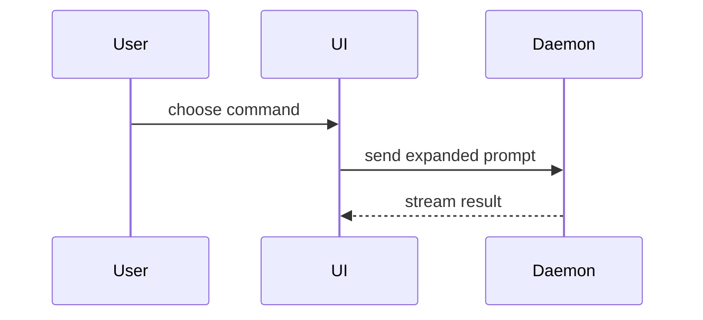

**Unattended.** This skill runs inside a factory run with nobody to ask. Where a person would normally be asked, it ends with a **`needs-human` outcome** instead: stop work and hand the calling task skill a question with your recommended answer, or a give-up reason that says what you tried. The task skill writes the outcome file. The task contract wins over this skill wherever they differ.

Write the PR body to the file the calling task skill names (the implementer uses `pr-body.md`). Rewrite it **in full** on every run, including a run that continues an existing PR: never append to an earlier body. `<n>` is the ticket number the task skill gives you.

Use this template:

```markdown
Closes #<n>

## Summary

<diagram, diff-sketch, or tree>

## Evidence

- **Before:** <screenshot/output/failing test run>
  **After:** <screenshot/output/passing test run>

## Merge Danger

**Door:** <one-way or two-way>

<optional: description>

**Blast Radius:** <one-word description>

<optional: potential ramifications of merge>
```

`Closes #<n>` and the three headings **Summary**, **Evidence** and **Merge Danger** are required exactly as written: a deterministic step checks for them, and a body missing any of them fails the run.

## Sections

Skip all preambles and keep prose brief. Use the project's domain language from `GLOSSARY.md`.

Unrelated issues you noticed while working don't go in the PR, and you don't fix them. Hand them to the task skill for the job summary.

### Summary

Pick the smallest view that makes the key point clear.

- Show logic or an algorithm as pseudocode:

```text
on(save)
  if content is unchanged
    return cached result
  write new content
  return fresh result
```

- Show runtime control flow as a call tree:

```text
submitForm
  createSession
    persistPrompt
    launchAgent
  navigateToSession
```

- Show UI structure as a component tree, including state and module boundaries that matter:

```text
<SessionPage> (apps/example/src/routes/session.tsx)
  useSessionEvents()
  <SessionToolbar>
    <RunSkillButton> (packages/ui)
```

- Show file responsibility or a broad refactor as a shallow file tree:

```text
src/
├── commands/       # parses user actions
├── sessions/       # owns session state
└── transport/      # sends API requests
```

- Show component interaction, control flow, or data flow with Mermaid:



- Use `diff` when the point is what changes and the surrounding shape already exists. Match the diff shape to the topic.

For a component change:

```diff
 <SessionPage>
   useSessionEvents()
   <SessionToolbar>
+    <RunSkillButton />
   <SessionTimeline>
+    <SkillResultCard />
```

For a file-layout change:

```diff
 src/
 ├── commands/
+│   └── show-me.ts       # expands the slash command
 ├── sessions/
-└── transport.ts
+└── transport/
+    ├── client.ts
+    └── stream.ts
```

For a call-tree or call-stack change:

```diff
 submitForm
   createSession
     persistPrompt
+    expandSkillMention
     launchAgent
-  navigateToSession
+  navigateToSession
+    subscribeToEvents
```

For a state or control-flow change:

```diff
 on(save)
-  write content
+  if content is unchanged
+    return cached result
+  write new content
+  invalidate cache
```

- Show the whole block when most of it is new, when omitted context would hide ownership or order, or when the reviewer needs a copyable target shape:

```ts
function expandSkill(command: string): string {
  const skillName = command.slice(1);
  return `use the ${skillName} skill`;
}
```

#### Guidance

Place each visual next to the short text it supports. Keep only the calls, files, props, states, and boundaries needed to make the change's key point clear to the reviewer.

You may use one of these, you may use several, it is unlikely you will use all of them. Use your judgement and don't overwhelm the reviewer.

### Evidence

Concrete evidence that the change works. Show a before and after.

**Evidence is only ever something this run actually produced**: output you ran and saw, a test you watched fail and then pass. Never invent, paraphrase into something stronger, or predict output. Missing or fake Evidence fails review.

Screenshots are S-tier, but only when the target repo's `CLAUDE.md` says how to take them and the change is visual. Attach them as a run artifact and point to it. Otherwise give a written description of the visual change, marked as such: "_Written description; no screenshot tooling in this repo._"

Execution-based evidence is A-tier. Test results, console output. Show the exact test that now fails and passes, using pseudocode.

What to show, by ticket class:

- **Bug fix:** the test or repro that failed before and passes after, with both outputs. Name the hypothesis that turned out correct.
- **Behaviour change:** an example input, with its output before and after.
- **UI:** screenshots or the marked written description, as above.
- **Refactor:** "No behaviour change", with the checks run as proof.
- **Docs or config:** what changed and how you checked it (a rendered page, a config that loads, a command that now works).

### Merge Danger

Describe whether it's a one-way or two-way door. You can walk back through two-way doors, but not one-way doors. A PR that is cheap to roll back is lower risk. Changes that involve destructive actions or hard-to-reverse decisions are one-way doors.

The blast radius is the potential impact or scope of the changes introduced by this PR. Consider all possibilities. Examples are layout shift, breakages for consumers, mobile responsiveness, etc.

Always declare each of these when the change has one, by name:

- security-sensitive code (auth, permissions, secrets, input handling, crypto)
- a new dependency
- a breaking change
- a migration
- a new or superseded ADR (always a one-way door)
